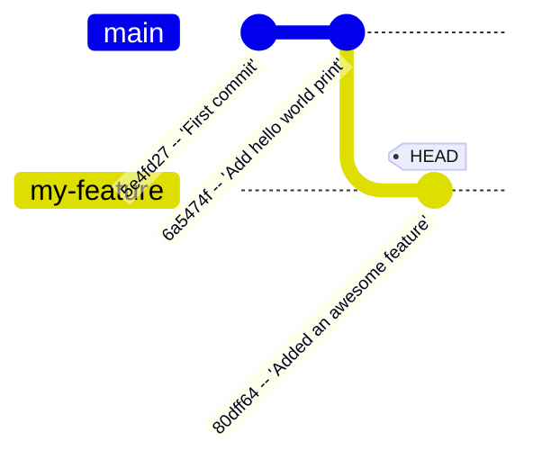
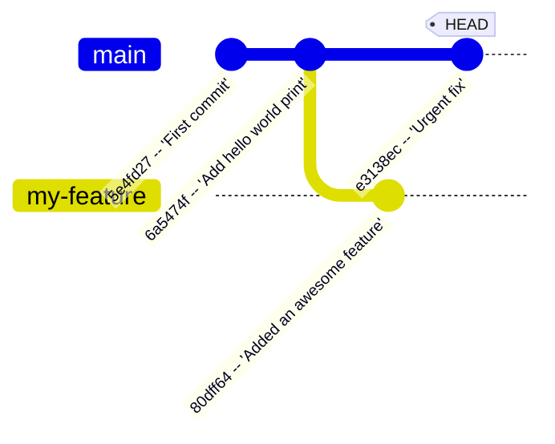

_This document is a short (not that short actually) tutorial about the Git tool. It is aimed towards Unix (Linux & MacOS) environments: if you are using Windows, the fundamental concepts still apply but the commands (probably) will not work._

# Preface

Git is a [version control system (VCS)](https://en.wikipedia.org/wiki/Version_control), which is a tool aimed at tracking code changes. It allows several people to work on the same code without losing anyone's work, to keep a history of modifications and to revert to previous versions, and much more. It is an industry-standard that almost every developer uses (except the rebels at Google), and powers platforms such as GitHub or GitLab.

# Overview

_NOTE: the following is a simplified view which does not perfectly model Git's inner workings, but is sufficient to get started. You can find more in-depth guides online (yes, Git is a very complex topic, and this guide barely scratches the surface. However, understanding it fully will already give you good comprehension of it)._

## Commits

Git keeps track of a sequence of _commits_, which encode a _diff_: the line-by-line code changes between before and after the commit. The point of a commit is both to act as a version, and to group related changes under a common, descriptive name (useful whenever you look back at the Git _history_).

Here's an example of diff:

```python
# Before
text = "I am a sausage."
print(text)
```

```python
# After
text = "I am a sausage."
print("Hello, World!")
print(text)
```

Git would generate the following diff:

```diff
~/dev/git-test $ git diff main
diff --git a/a.py b/a.py
index bdebfe6..6806c1f 100644
--- a/a.py
+++ b/a.py
@@ -1,3 +1,4 @@
-# Before
+# After
 text = "I am a sausage."
+print("Hello, World!")
 print(text)
~/dev/git-test $
```

The interesting part is the lines highlighted in red (indicating a line got deleted) and in green (indicating a line got added). If a line gets modified, Git interprets it as if the previous line got removed and the new (modified) line got inserted in the same place.

To save the changes to Git (of course, they are already saved to your filesystem), you can create a commit:

```console
~/dev/git-test $ git status
On branch main
Changes not staged for commit:
  (use "git add <file>..." to update what will be committed)
  (use "git restore <file>..." to discard changes in working directory)
        modified:   a.py

no changes added to commit (use "git add" and/or "git commit -a")
~/dev/git-test $ git add .
~/dev/git-test $ git status
On branch main
Changes to be committed:
  (use "git restore --staged <file>..." to unstage)
        modified:   a.py

~/dev/git-test $ git commit -m "Add hello world print"
[main 6a5474f] Add hello world print
 1 file changed, 2 insertions(+), 1 deletion(-)
~/dev/git-test $
```

The `git add .` command allows us to _stage_ all changes, which represents the changes that will be part of the commit. Notice from the `git status` output that it added the `a.py` file to the staged files; you can also select individual files or even individual changes within a file to stage instead of everything (this is easiest to do from your code editor's Git interface).

The `git commit` command is what actually creates the commit, taking as a parameter `-m` the _commit message_ (see below).

The `git log` command allows us to view the history of all commits (which you can also view by clicking "Commits" or "History" in GitHub/GitLab):

```yaml
~/dev/git-test $ git log
commit 6a5474f733c9e128ab5d0b8b1dc4fe22057601ff (HEAD -> main)
Author: Thibault M <thibaultmonni@gmail.com>
Date:   Tue Oct 13 15:19:10 2026 +0200

    Add hello world print

commit 5e4fd274b084026df19a87024213e1cb4abc8fac
Author: Thibault M <thibaultmonni@gmail.com>
Date:   Tue Oct 13 14:24:05 2026 +0200

    First commit
~/dev/git-test $
```

Here, "Add hello world print" and "First commit" are called the _commit message_, which acts as a title to each commit. Moreover, `6a5474f733c9e128ab5d0b8b1dc4fe22057601ff` and `5e4fd274b084026df19a87024213e1cb4abc8fac` are called the _commit hash_, which are unique identifiers associated with each commit. Git also stores additional information such as the author, the date (including a timezone, here UTC+02:00), and a few other things that are hidden by default.

## Branches

A branch is a way to organize commits before _merging_ them back. A commit is always tied to a specific branch. Usually, the central branch (which Git hosting platforms often call the _default branch_) of a repository is called `main` or `master` - in our example, it is `main` (this "central branch" does not exist from Git's perspective, it is simply a convention):

```console
~/dev/git-test $ git status
On branch main

nothing to commit, working tree clean
~/dev/git-test $
```

There are several cases when you might want to create a branch. For example, imagine you want add a new complex feature to your program.

```console
~/dev/git-test $ git branch my-feature
~/dev/git-test $ git branch
* main
  my-feature
~/dev/git-test $
```

The `git branch my-feature` command created a branch named "my-feature". The `git branch` command lists all branches; the `*` symbol tells us that the `main` branch is currently active (also visible through `git status`), meaning any commit made will go to the `main` branch... which is unfortunate.

```console
~/dev/git-test $ git switch my-feature
Switched to branch 'my-feature'
~/dev/git-test $ git log --graph --oneline
* 6a5474f (HEAD -> my-feature, main) Add hello world print
* 5e4fd27 First commit
~/dev/git-test $
```

Thankfully, the `git switch` command allows us to change the active branch. But what does `git switch` do, really? The answer lies in the following command. Notice the `HEAD -> my-feature`. This signifies that the `HEAD` pointer points to the `my-feature` branch. When a Git commit is made, it is added to the location pointed to by `HEAD`; here, it would resolve to `my-feature`. Furthermore, when changing the `HEAD` pointer, Git **modifies your files on disk** to match the newly active branch (if you had unsaved changes, Git will safely transfer them over, so this operation isn't risky).

Now, let's add our feature.

```diff
~/dev/git-test $ git diff HEAD
diff --git a/a.py b/a.py
index 6806c1f..d3ea35e 100644
--- a/a.py
+++ b/a.py
@@ -1,4 +1,5 @@
 # After
-text = "I am a sausage."
+text = "I am NOT a sausage."
 print("Hello, World!")
 print(text)
+print("Awesome feature!")
~/dev/git-test $ git add .
~/dev/git-test $ git commit -m "Added an awesome feature"
[my-feature 80dff64] Added an awesome feature
 1 file changed, 2 insertions(+), 1 deletion(-)
~/dev/git-test $
```

We added our feature, here's how that looks:



Now, imagine we want to add an unrelated fix to the program, that we have to push to production. We could just commit it the `my-feature` branch and push that branch... but it contains a bug! The program now prints the nonsensical "I am NOT a sausage" phrase. We can thus be glad we used a branch to implement the new feature, because we can simply go back to the stable `main` branch whenever we need.

```diff
~/dev/git-test $ git switch main
Switched to branch 'main'
~/dev/git-test $ nano a.py
~/dev/git-test $ git diff HEAD
diff --git a/a.py b/a.py
index 6806c1f..ba4b842 100644
--- a/a.py
+++ b/a.py
@@ -1,4 +1,3 @@
 # After
 text = "I am a sausage."
-print("Hello, World!")
 print(text)
~/dev/git-test $ git add .
~/dev/git-test $ git commit -m "Urgent fix"
[main e3138ec] Urgent fix
 1 file changed, 1 deletion(-)
~/dev/git-test $
```

Which yields the following commit graph:

```console
~/dev/git-test $ git log --graph --oneline --all
* e3138ec (HEAD -> main) Urgent fix
| * 80dff64 (my-feature) Added an awesome feature
|/
* 6a5474f Add hello world print
* 5e4fd27 First commit
~/dev/git-test $
```



This is great, but we would like to be able to combine the changes from several branches when they are ready. This is described in the [Divergence section](#divergence).

## Remotes

Git assigns a list of _remotes_ to each repository.

```console
~/dev/frites-2027 $ git remote -v
origin  https://gitlab.com/ftc-civ/frites/2027.git (fetch)
origin  https://gitlab.com/ftc-civ/frites/2027.git (push)
~/dev/frites-2027 $
```

Here, my local clone has the remote (_upstream_) GitLab repository marked as _origin_. This allows me to sync my local clone to the repository stored on GitLab:

```console
~/dev/frites-2027 $ git status
On branch main
Your branch is behind 'origin/main' by 2 commits, and can be fast-forwarded.
  (use "git pull" to update your local branch)

nothing to commit, working tree clean
~/dev/frites-2027 $
```

Here, `git status` informs us that the remote repository (GitLab) has the same commit history as our local clone, but with 2 additional commits at the end. Notice `origin/main` is actually a branch, which is _tracked_ by your local `main` branch.

The `git status` command does not make any request to the remote over the Internet, so it may not know if commits have been added. Thus, you might have to run `git fetch` to allow Git to know the local clone is behind:

```console
~/dev/frites-2027 $ git status
On branch main
Your branch is up to date with 'origin/main'.

nothing to commit, working tree clean
~/dev/frites-2027 $ git fetch
remote: Enumerating objects: 41, done.
remote: Counting objects: 100% (41/41), done.
remote: Compressing objects: 100% (21/21), done.
remote: Total 22 (delta 13), reused 3 (delta 0), pack-reused 0 (from 0)
Unpacking objects: 100% (22/22), 5.45 KiB | 372.00 KiB/s, done.
From https://gitlab.com/ftc-civ/frites/2027
   6b2b06b..bad6969  main       -> origin/main
~/dev/frites-2027 $ git status
On branch main
Your branch is behind 'origin/main' by 2 commits, and can be fast-forwarded.
  (use "git pull" to update your local branch)

nothing to commit, working tree clean
~/dev/frites-2027 $
```

The `git pull` command allows us to update the local repository (if you have local unsaved changes, you might have to run `git stash && git pull && git pop` instead). Git simply updates your current branch (here, `main`) to match its _remote tracking branch_ (here, `origin/main`), taking the diffs of the additional commits from the remote and applying them in order:

```console
~/dev/frites-2027 $ git pull
Updating 4c24407..6b2b06b
Fast-forward
 docs/getting-started/README.md          |  4 +++-
 docs/getting-started/ftc-programming.md | 79 ++++++++++++++++++++++++++++++++++++++++++++++++++++++++++++++++++++++---------
 docs/getting-started/git.md             | 45 +++++++++++++++++++++++++++++++++++++++++++++
 3 files changed, 118 insertions(+), 10 deletions(-)
 create mode 100644 docs/getting-started/git.md
~/dev/frites-2027 $
```

If, instead, your local repository is _ahead_ (that is, it has commits that the remote does not yet have), you can run `git push` to sync the remote to your local changes (so, this is the same as `git pull` but the other way around).

## Divergence

Sometimes, your local repository is both ahead and behind the remote: we call this a _divergence_.

```console
~/dev/frites-2027 $ git log main origin/main --graph --oneline -n 5
* 10f4667 (HEAD -> main) Divergent commit
| * bad6969 (origin/main, origin/HEAD) Implement PID velocity control for field centric movement
| * 4d644c7 Extend git guide in doc/
|/
* 6b2b06b Start a git tutorial in docs/
* e50f1bc Extend & reformat docs
~/dev/frites-2027 $
```

In this scenario, the local repository is ahead (indicated by the "HEAD" annotation) one commit: `10f4667`, and behind (indicated by the "origin/HEAD" annotation) two commits: `4d644c7` then `bad6969`.

### Clean rebase

There are several ways to fix this divergence. In many cases, it will require a single command and you will be done.

```console
~/dev/frites-2027 $ git log main origin/main --graph --oneline -n 5
* 5eaf4fc (HEAD -> main) Divergent commit without conflicts
| * bad6969 (origin/main, origin/HEAD) Implement PID velocity control for field centric movement
| * 4d644c7 Extend git guide in doc/
|/
* 6b2b06b Start a git tutorial in docs/
* e50f1bc Extend & reformat docs
~/dev/frites-2027 $ git rebase
Successfully rebased and updated refs/heads/main.
~/dev/frites-2027 $ git status
On branch main
Your branch is ahead of 'origin/main' by 1 commit.
  (use "git push" to publish your local commits)

nothing to commit, working tree clean
~/dev/frites-2027 $
```

The `git rebase` (or equivalently, `git pull --rebase` which also fetches before rebasing, whereas `git rebase` operates offline similarly to `git status`) managed to merge the changes without any issues, yielding the following history, said _linear_:

```console
~/dev/frites-2027 $ git log --oneline -n 5
0a992ed (HEAD -> main) Divergent commit without conflicts
bad6969 (origin/main, origin/HEAD) Implement PID velocity control for field centric movement
4d644c7 Extend git guide in doc/
6b2b06b Start a git tutorial in docs/
e50f1bc Extend & reformat docs
~/dev/frites-2027 $ git fetch && git status
On branch main
Your branch is ahead of 'origin/main' by 1 commit.
  (use "git push" to publish your local commits)

nothing to commit, working tree clean
~/dev/frites-2027 $
```

And the divergence is solved! Note that the commit hash for "Divergent commit without conflicts" changed (from `5eaf4fc` to `0a992ed`). The reason for this is that when rebasing, Git deletes the old commits and re-creates them with the same diff and description, but not the same hash.

### Merge conflicts

_Let's be clear. This is the worst nightmare for anyone getting started with Git. If you get a merge conflict, don't cry: just close your code editor and never open it again._

In other cases, when your local commits and the remote commits modified the same part of the code, Git does not know how to proceed and asks you to _resolve conflicts_.

There are two ways to proceed: merge and rebase. While merges are very useful in many scenarios, they create a non-linear history and create a _merge commit_ (even though nobody wants to know that you had to merge your local changes into the remote). Thus, a rebase, even though it can require more work, is often the preferred solution.

#### Rebase

Take the following divergence, where we wish to merge `my-branch` into `main`.

```
          A---B---C my-branch
         /
    D---E---F---G main
```

The `git rebase` command allows us to merge both with a linear history: the commits `A`, `B`, `C` get deleted then are recreated on the top of the `main` branch:

```
                  A--B--C my-branch
                 /
    D---E---F---G master
```

> TODO: finish this section.
